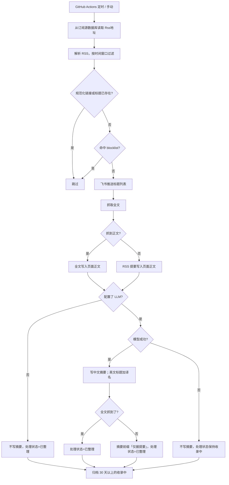

<div align="center">

# 📡 Notion RSS

**基于 Notion 的个人 RSS 阅读器，支持飞书通知推送**

[](https://www.python.org/)
[](https://developers.notion.com/)
[](https://github.com/features/actions)
[](https://www.feishu.cn/)

自动抓取 RSS 订阅源，抓取全文后写入 Notion。中文摘要是可选的，配上 LLM 密钥才会生成。

</div>

---

## ✨ 功能特性

- **📋 RSS 订阅管理** — 从 Notion「📡 RSS 订阅源」读取订阅（`名称` + `Rss地址`）
- **🔄 自动抓取与过滤** — 只收录时间窗口内的新文章（Actions 里默认 24 小时）
- **🔗 链接去重** — 去掉 `utm_*`、`f=rss` 等跟踪参数后，按规范化链接或完全相同的标题跳过
- **📝 正文** — 默认就抓全文（不需要 LLM）。抓不到时把 RSS 提要写入正文
- **✍️ 中文摘要** — 可选。三个 LLM Secret 都配上之后，才生成 1–2 句中文摘要，并把英文标题写成「中文译名｜原标题」
- **🔔 飞书通知** — 每日新文章列表推送到飞书群
- **🧹 自动清理** — 归档 30 天以上、仍是「收录中」的条目。没配 LLM 时新文章会标成「已整理」，因此不会被这条规则清掉
- **🔁 补跑** — 每天 11:30（北京时间）给近 3 天里正文为空的页面补全文；配了 LLM 时同时补摘要

全文抓取、去重、以及把处理状态写成「已整理」都不需要 LLM。没配 `LLM_API_KEY`、`LLM_BASE_URL`、`LLM_MODEL` 时不写摘要、不翻译标题。

---

## 🔄 工作流程



---

## 📁 项目结构

```
notion-rss/
├── main.py              # 入口。RUN_MODE=backfill 时补正文，配了 LLM 再补摘要
├── feed.py              # RSS 抓取、去重、黑名单
├── enrich.py            # 全文 + 摘要编排
├── fulltext.py          # 抓页面并用 trafilatura 抽正文
├── summarize.py         # OpenAI 兼容 Chat Completions
├── urlnorm.py           # 去掉跟踪参数
├── blocklist.py         # 读取 blocklist.txt
├── blocklist.txt        # 关键词 / 来源黑名单（默认关闭）
├── notion.py            # Notion 读写
├── parser.py            # HTML / 纯文本 → Notion blocks
├── feishu.py            # 飞书 Webhook
├── requirements.txt
├── .env.example
└── .github/workflows/
    ├── feed.yml         # 09:00 北京时间
    ├── news.yml         # 05:40 北京时间，写入资讯库
    └── backfill.yml     # 11:30 北京时间补正文；配了 LLM 再补摘要
```

---

## 🚀 快速开始

### 前置条件

- Python 3.12+
- Notion Integration（本仓库用的是 PopLab RSS Bot）已分享给两个数据库
- 可选：飞书群机器人 Webhook
- 可选：DeepSeek / 通义千问 / OpenAI 等兼容接口的 Key

### 1. Notion 属性

代码按下面的名字读写。订阅源库：

| 属性名 | 类型 | 说明 |
|--------|------|------|
| `名称` | Title | 订阅源名称，黑名单的 `source:` 匹配它 |
| `Rss地址` | URL | RSS 地址，非空才会抓 |

文章库（📰 每日资讯速览 / Reader）里，**这次改动实际会写的属性**：

| 属性名 | 类型 | 什么时候写 |
|--------|------|------------|
| `名称` | Title | 每次。只有 LLM 摘要成功且标题是英文时，才写成 `中文译名｜Original Title` |
| `听原文` | URL | 每次。存去掉跟踪参数后的链接 |
| `发布日期` | Date | RSS 里有发布时间时 |
| `处理状态` | Status | 正文写入后为 `已整理`。配了 LLM 但模型失败时保持 `收录中` |
| `摘要` | Rich text | 仅 LLM 成功时。库里没有这个属性时会退回不写摘要 |

`处理状态` 需要已经有选项 `收录中` 和 `已整理`。页面正文是文章内容，不在属性里。

`来源`、`类型`、`标签`、`赛道`、`语言`、`AIx 消费赛道`、`标准译文`、`⭐ 收藏` 这次不写，避免属性名不一致导致整页创建失败。

### 2. 配置环境变量

```bash
cp .env.example .env
```

---

## 🔑 要添加的 Secrets

仓库 **Settings → Secrets and variables → Actions → New repository secret**。

原有的继续留着：

| Secret | 必填 | 说明 |
|--------|------|------|
| `NOTION_API_TOKEN` | 是 | Notion Integration Token（PopLab RSS Bot） |
| `NOTION_READER_DATABASE_ID` | 是 | `feed.yml` 写入的文章库 |
| `NOTION_FEEDS_DATABASE_ID` | 是 | `feed.yml` 读取的订阅源库 |
| `NEWS_READER_DATABASE_ID` | 资讯流需要 | `news.yml` / 补跑写入的文章库（📰 每日资讯速览） |
| `NEWS_FEEDS_DATABASE_ID` | 资讯流需要 | `news.yml` 读取的订阅源库（📡 RSS 订阅源） |
| `FEISHU_WEBHOOK_URL` | 否 | 不填则飞书推送失败，Notion 写入不受影响 |

**默认不需要下面三个。** 全文、去重、`已整理` 在不配置它们时就会跑。三个都填上之后，才会额外写中文摘要和英文标题的译名。缺任何一个等于没开摘要。值不要加引号。

| Secret | 示例 | 说明 |
|--------|------|------|
| `LLM_API_KEY` | `sk-...` | 供应商给的 Key |
| `LLM_BASE_URL` | 见下表 | 兼容接口的根路径，**不要**带 `/chat/completions` |
| `LLM_MODEL` | `deepseek-chat` | 该供应商的模型名 |

`LLM_BASE_URL` 按供应商填：

| 供应商 | `LLM_BASE_URL` | `LLM_MODEL` 示例 |
|--------|----------------|------------------|
| DeepSeek | `https://api.deepseek.com/v1` | `deepseek-chat` |
| 通义千问 | `https://dashscope.aliyuncs.com/compatible-mode/v1` | `qwen-plus` |
| OpenAI | `https://api.openai.com/v1` | `gpt-4o-mini` |

换供应商只改这三个 Secret，不用改代码。每天大约 200 篇，摘要输入会截到约 4000 字，并发默认 3。

保存 Secret 之后不用改 YAML。下一次 `feed.yml`（每天 09:00 北京时间）和 `news.yml`（每天 05:40 北京时间）会自动带上。也可以在 Actions 页手动跑。

补跑工作流每天 11:30（北京时间）跑一次，也可手动触发。近 3 天内正文为空的页面会重新抓全文；抓不到就留空，下次再试。

配了 LLM 时，同一轮还会处理「摘要为空」或「处理状态 = 收录中」的行：

- 摘要已经有了、只是状态还停在收录中：改成已整理，不再调用模型
- 摘要为空：重新抓全文并生成摘要。模型失败则保持收录中，第二天还会再试
- 抓不到全文（付费墙、403、36kr 安全验证等）：用标题和已有正文/提要写摘要，并加上前缀 `「仅据提要」`

### 可选环境变量

不放进 Secrets 也能跑。要改的话可以写成 Actions 的 Variables，或写在 `.env` 里。

| 变量 | 默认 | 说明 |
|------|------|------|
| `RUN_FREQUENCY` | 工作流里是 `86400` | 收录窗口（秒）。代码默认 259200 |
| `FULLTEXT_FETCH` | 开 | 设为 `0` 时不抓网页，正文只用 RSS HTML |
| `FULLTEXT_TIMEOUT` | `12` | 单页读取超时（秒），另外有 5 秒连接超时 |
| `FULLTEXT_BODY_MAX_CHARS` | `30000` | 写入 Notion 正文的字数上限 |
| `LLM_CONCURRENCY` | `3` | 同时进行的模型请求数，最大 8 |
| `LLM_INPUT_MAX_CHARS` | `4000` | 送给模型的材料长度 |
| `ENRICH_WORKERS` | `4` | 抓全文的线程数，最大 8 |
| `BACKFILL_DAYS` | `3` | 补跑回看的天数 |
| `RUN_MODE` | `ingest` | 设为 `backfill` 时补空正文；配了 LLM 再补摘要 |
| `BLOCKLIST_KEYWORDS` | 空 | 逗号分隔，追加到 `blocklist.txt` 的关键词 |
| `BLOCKLIST_SOURCES` | 空 | 逗号分隔，按订阅源名称丢弃 |

---

## 🚫 黑名单

编辑仓库根目录的 `blocklist.txt`。默认每一行都是注释，**一条都不会拦**。

```
# 股价
# source: 某行情快讯
```

去掉 `#` 即生效：普通行匹配标题和 RSS 提要（子串、不区分大小写）；`source:` 行匹配订阅源的 `名称`。短词容易误伤，尽量写完整说法。

---

## 📋 处理状态

| 情况 | 处理状态 | 摘要 | 正文 |
|------|----------|------|------|
| 没配 LLM，抓到全文 | 已整理 | 空 | 全文 |
| 没配 LLM，抓取失败 | 已整理 | 空 | RSS 提要 |
| 配了 LLM，抓到全文，模型成功 | 已整理 | 1–2 句中文 | 全文 |
| 配了 LLM，抓取失败，模型成功 | 已整理 | 以「仅据提要」开头 | RSS 提要 |
| 配了 LLM，模型失败 | 收录中 | 空，留给补跑 | 抓到的全文，或 RSS 提要 |

没配 LLM 时，抓到全文和只剩 RSS 提要都标成「已整理」。库里现成的状态是 `收录中`、`总结中`、`已整理`。`总结中` 是摘要还在进行的意思，用在这里会像还没做完。没有一个现成选项表示「只有提要」，所以两种正文都用 `已整理`，表示这行已经处理过，不需要 Notion AI。`收录中` 只留给「配了模型但这次调用失败」。

---

## 🧪 本地检查

```bash
pip install -r requirements.txt
python -m unittest tests.test_enrich -v
RUN_LIVE_FETCH=1 python -m unittest tests.test_fulltext_live -v
```

第二条会访问几篇真实网页，检查正文抽取，以及付费墙/验证页会返回空。没有 Key 时不会打到模型。

---

## 🛠️ 技术栈

| 依赖 | 用途 |
|------|------|
| [feedparser](https://feedparser.readthedocs.io/) | RSS/Atom 解析 |
| [requests](https://requests.readthedocs.io/) | Notion、飞书、网页和 LLM |
| [trafilatura](https://trafilatura.readthedocs.io/) | 从 HTML 抽出正文 |
| [markdownify](https://github.com/matthewwithanm/python-markdownify) | RSS HTML 转 Markdown |
| [python-dotenv](https://github.com/theskumar/python-dotenv) | 本地环境变量 |
